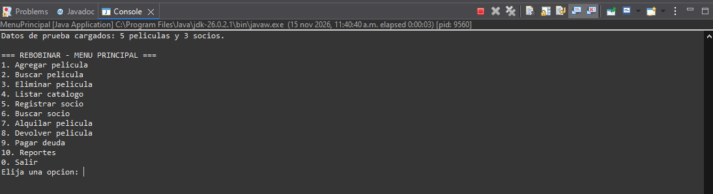
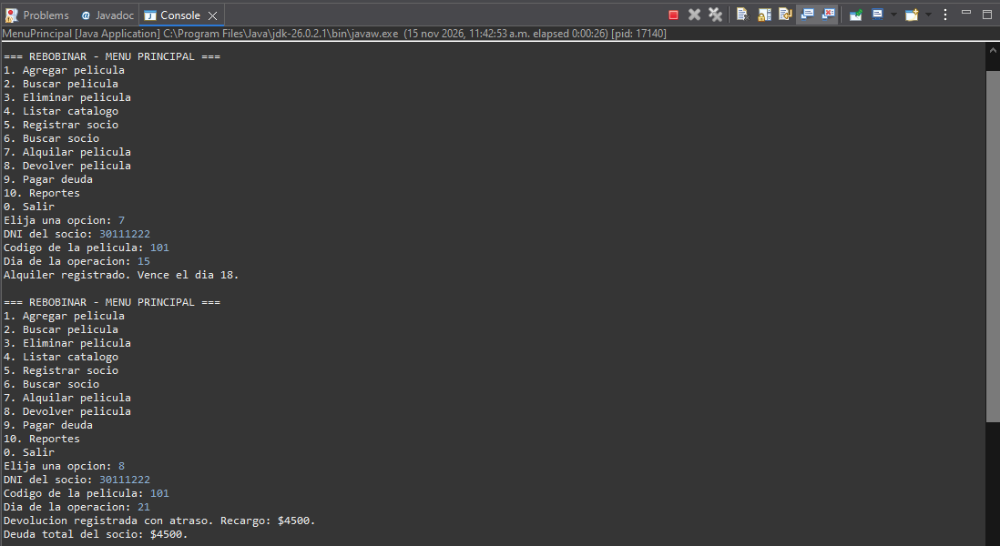
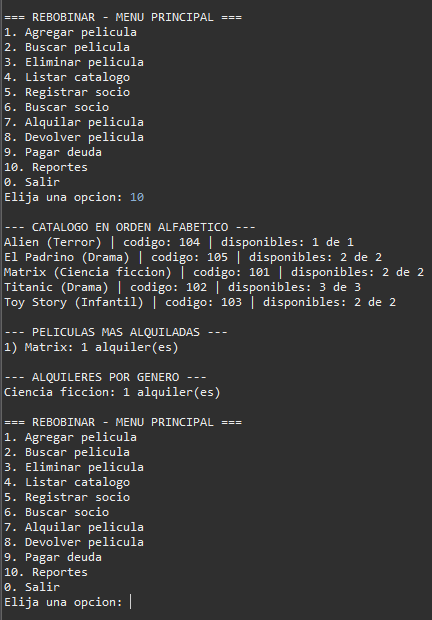

# Rebobinar: videoteca de barrio

Proyecto integrador de Algoritmos y Estructuras de Datos 2 (AED2), ISSD, 2026.
Docente: Prof. Silvana Burgos. Grupo 12.

**Integrantes**

| Apellido | Usuario de GitHub | Módulo |
|---|---|---|
| Sacco | [@JuanDSacco](https://github.com/JuanDSacco) | Catálogo de películas |
| Roman | [@LahuelRS](https://github.com/LahuelRS) | Socios y alquileres |
| Sanchez | [@santiisanchez6-png](https://github.com/santiisanchez6-png) | Menú, reportes e integración |

**Tablero Kanban:** https://trello.com/b/RaQfvhnN/grupo12-emprendimiento-digital

## Emprendimiento
Rebobinar es una videoteca de barrio al estilo Blockbuster: alquila películas a sus socios por unos días y cobra un recargo si se devuelven tarde.

## Problema que resuelve
Hoy el mostrador lleva todo a mano: para saber si hay copias de una película, quién la tiene o si un socio debe algo, hay que revisar fichas una por una. El programa centraliza el catálogo, los socios y los alquileres, encuentra cualquier dato al instante por código o DNI y genera reportes ordenados.

## Tema elegido
**Clase 7: Mapas.** En un mostrador todo se busca por un identificador: la película por su código y el socio por su DNI. Un mapa va directo a esa llave sin recorrer el catálogo completo, y un `TreeMap` da los reportes ordenados sin ordenar a mano.

Cómo se cumple el mínimo técnico:
- `Map<Integer, Pelicula>`: el catálogo, código → película. Las búsquedas, el alta y la baja trabajan directamente sobre la llave.
- `Map<String, Socio>`: los socios por DNI, y `Map<String, Map<Integer, Integer>>` para registrar qué películas tiene cada socio y qué día las retiró.
- Recorridos con `entrySet` en los listados, en el ranking y en los reportes.
- `TreeMap` en los tres reportes: catálogo alfabético, películas más alquiladas (de mayor a menor) y alquileres por género.

## Funcionalidades
- [x] Alta, baja, búsqueda (por código o por parte del título) y listado de películas
- [x] Alta y búsqueda de socios por DNI, con sus películas en poder y su deuda
- [x] Alquiler con validaciones: socio registrado, sin deuda, máximo 3 películas, película existente y con copias
- [x] Devolución con cálculo de recargo: plazo de 3 días y $1500 por cada día de atraso
- [x] Pago de deuda, que vuelve a habilitar al socio
- [x] Reportes ordenados: catálogo alfabético, más alquiladas y alquileres por género
- [x] Menú por consola que no se interrumpe ante opciones o datos inválidos

## Fuera de alcance
Facturación con detalle y total, pagos reales, usuarios con contraseña, persistencia en archivos o base de datos, fechas reales (las operaciones se registran con un número de día) e interfaz gráfica. El programa funciona por consola.

## Tecnologías
Java (compatible con Java 8 o superior), aplicación de consola, sin librerías externas. Desarrollado con Eclipse. Control de versiones con Git y GitHub; seguimiento de tareas con Trello.

## Cómo ejecutar

**Desde Eclipse**
1. Clonar el repositorio o descargarlo como ZIP.
2. Crear un proyecto Java y copiar los archivos de `/src` a la carpeta `src` del proyecto. Todas las clases están en el paquete por defecto.
3. Ejecutar `MenuPrincipal` con Run. El programa carga 5 películas y 3 socios de prueba al iniciar.

**Desde la línea de comandos**, parado en la carpeta del repositorio:

    javac -d bin src/*.java
    java -cp bin MenuPrincipal

**Pruebas**: los programas de prueba están en `/pruebas` y usan las clases de `/src`:

    javac -d bin src/*.java pruebas/*.java
    java -cp bin PruebaCatalogo
    java -cp bin PruebaAlquileres
    java -cp bin PruebaReportes

## Estructura del repositorio
- `bitacora.md`: avance diario
- `/src`: código (`Pelicula`, `Catalogo`, `Socio`, `Alquileres`, `Reportes`, `MenuPrincipal`)
- `/docs`: requerimientos, contratos entre módulos y diagrama de clases
- `/pruebas`: programas de prueba y documentación de los casos
- `/kanban`: capturas diarias del tablero

## Capturas de pantalla

## Pruebas realizadas
Cada módulo tiene un programa de prueba con datos fijos y un documento con la tabla de casos, resultado esperado y resultado obtenido:

- Catálogo: `pruebas/PruebaCatalogo.java` y `pruebas/pruebas-catalogo.md`
- Socios y alquileres: `pruebas/PruebaAlquileres.java` y `pruebas/pruebas-alquileres.md` (24 casos)
- Reportes y menú: `pruebas/PruebaReportes.java` y `pruebas/pruebas-menu-reportes.md` (11 casos automatizados y 16 manuales)
- Sistema completo: `pruebas/pruebas-integracion.md` (21 casos recorriendo el menú de punta a punta)

Todos los casos pasaron. Entre los casos borde cubiertos están los reportes con el sistema vacío, dos películas con el mismo título, los empates en el ranking, la película dada de baja que sigue en el historial y las entradas no numéricas en el menú.

## Conclusiones
- Elegir la estructura según cómo se busca el dato simplificó el código: con un mapa, buscar por código o por DNI es una sola línea, sin recorrer colecciones. El `TreeMap` resolvió los reportes ordenados sin escribir ningún algoritmo de ordenamiento.
- Acordar por escrito los métodos de cada módulo antes de programar (`/docs/contratos`) permitió trabajar en paralelo y que la integración final fuera casi inmediata.
- Decidir qué devuelve cada método evitó errores en el menú: `alquilar` devuelve el motivo del rechazo para mostrarlo tal cual, y `devolver` distingue entre devolución sin recargo (`0`) y una película que el socio no tenía (`-1`).
- Aprendimos a evitar problemas típicos de Java: leer siempre con `nextLine` para que el Enter pendiente no saltee una lectura, no exponer las colecciones internas (el catálogo entrega un mapa de solo lectura y los alquileres una copia de la lista) y controlar el `null` que devuelve `get` cuando la llave no existe.
- Lo que mejoraríamos con más tiempo: guardar los datos en archivos para que no se pierdan al cerrar, usar fechas reales con `java.time` en lugar del número de día, y sumar la facturación que quedó fuera del alcance.
